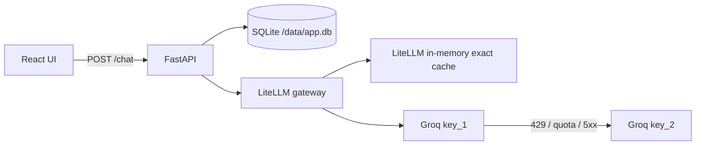

# Relay — LLM chatbot with key failover and response caching

React + FastAPI + LiteLLM + SQLite. Built for the Lyftr AI full-stack assignment. The working provider is **Groq**, using GPT-OSS 20B (`groq/openai/gpt-oss-20b`).

## 1. Live URLs

Replace these placeholders **after deployment** and commit this README:

- Frontend: `https://YOUR-FRONTEND.onrender.com`
- Backend: `https://YOUR-BACKEND.onrender.com`
- Health: `https://YOUR-BACKEND.onrender.com/health`
- Repository: `https://github.com/YOUR-USERNAME/lyftr-chat`
- Demo: `YOUR_PUBLIC_VIDEO_URL`

See [DEPLOYMENT.md](DEPLOYMENT.md) for deployment and [DEMO.md](DEMO.md) for the recording checklist. The source package itself is not a live deployment.

## 2. Run locally: with Docker and without

Prerequisites: Docker Desktop with Compose v2, or Python 3.12 and Node 22 for a native setup; two distinct Groq API keys. Create keys at [Groq Console](https://console.groq.com/keys). Both keys must have access to `openai/gpt-oss-20b`. Keys in the same organization may share rate limits; two keys alone do not guarantee independent quota. The assignment's request-scoped failure simulation demonstrates failover without exhausting quota.

Copy `.env.example` to `.env` if you have not already created it (`Copy-Item .env.example .env` on PowerShell; `cp .env.example .env` on Bash). Do not overwrite an existing working `.env`. Set the following values, replacing the key placeholders with your own secrets:

```dotenv
LLM_API_KEYS=replace_key_1,replace_key_2
LLM_MODEL=groq/openai/gpt-oss-20b
DATABASE_URL=sqlite:////data/app.db
ALLOWED_ORIGINS=http://localhost:3000
ENABLE_FAILURE_SIMULATION=true
LLM_TIMEOUT_SECONDS=30
VITE_API_URL=http://localhost:8000
PORT=8000
```

Keep `.env` private and update `.env.example` with the same model ID but placeholder keys only. Always set `LLM_MODEL` explicitly: the original backend code has a Gemini default when this variable is absent. Never expose keys to the frontend or commit them to GitHub.

### Docker

From the repository root:

```sh
make up
# On Windows if make is missing:
docker compose up --build -d
```

Open http://localhost:3000. Backend: http://localhost:8000/health.

```sh
make down
# Windows equivalent: docker compose down
```

After changing backend environment variables, apply them with `docker compose up -d --force-recreate backend` (no rebuild needed).

The named `chat_data` volume is designed to persist across `down` and `up`. Do not run `docker compose down -v` unless you intentionally want to erase chat history. `make logs` streams logs.

### Without Docker (Windows PowerShell)

From the root, set the local database path in `.env` to `sqlite:///./app.db` instead of `/data/app.db`. If you later return to Docker restore the `/data` value.

```powershell
cd backend
py -3.12 -m venv .venv
.\.venv\Scripts\python.exe -m pip install -r requirements-dev.txt
.\.venv\Scripts\python.exe -m uvicorn app.main:app --env-file ../.env --port 8000
```

In a second terminal, from the repository root:

```powershell
cd frontend
npm install
npm run dev
```

On Bash use `python3.12 -m venv .venv`, `.venv/bin/python` in place of the Windows interpreter and otherwise the same commands. The frontend defaults to `http://localhost:8000`; for another target set `VITE_API_URL` before running Vite. To test the production frontend build: `npm run build`.

### Configuration

| Variable | Purpose |
|---|---|
| `LLM_API_KEYS` | Comma-separated distinct keys, server only |
| `LLM_MODEL` | `groq/openai/gpt-oss-20b` (explicitly set for both Groq keys) |
| `DATABASE_URL` | SQLite file URL; Docker/production `sqlite:////data/app.db` |
| `ALLOWED_ORIGINS` | Comma-separated allowed frontend origins |
| `ENABLE_FAILURE_SIMULATION` | Set `true` for assignment evaluation; otherwise `false` |
| `LLM_TIMEOUT_SECONDS` | Timeout per provider attempt (30 by default) |
| `VITE_API_URL` | Public backend URL, built into frontend |
| `PORT` | Backend container listening port; defaults to 8000 |

## 3. Design decisions: key fallback, caching, SQLite session storage



- **Key fallback:** an ordered gateway explicitly calls LiteLLM once per key, with SDK retries disabled, to preserve deterministic key IDs and failure counts. The same configured Groq model (GPT-OSS 20B) runs across the pool. It advances on all upstream exceptions or malformed provider responses (including 429/quota/5xx, timeouts and invalid credentials). The failure simulation skips selected keys only for that request. All keys unavailable returns 503, not a fake answer. No actual credentials are returned or printed by app code.
- **Cache:** LiteLLM's built-in `Cache(type='local')`, with an explicit SHA-256 key over model + complete LLM message array. Synchronous get/add operations avoid a race from asynchronous background cache writes. No session ID, API key or metadata enters the cache key. Cached text and provider-reported usage are stored together. Each cache response uses current server-measured latency, `key_id: null`, `fallback_attempts: 0`. Simulation bypasses cache reads/writes intentionally to demonstrate a real provider attempt even for a previously cached prompt. Cache lasts up to 24 hours and is lost when the backend process restarts; durable cache is not required.
- **Storage:** `sessions` holds the effective system prompt; `messages` holds user/assistant pairs and assistant metadata. A transaction writes both messages only after successful inference/cache resolution. Failed/invalid requests leave history unchanged. Ordered reads use the session ID and increasing message IDs. WAL improves concurrent reads. In-process striped locks serialize simultaneous chat requests for the same session. Deploy one backend worker/instance because the cache and locks are process-local.
- **Tokens:** read `prompt_tokens` and `completion_tokens` from LiteLLM response usage, never sum the token counters across turns. The prompt itself contains history, so subsequent input-token counts can naturally increase. On cache hits return stored usage, not zero; this is original inference usage, not newly billed tokens.
- **Security:** API keys belong in backend environment variables. CORS explicitly allows configured frontend origins. Untrusted LLM text is displayed as text, not HTML. Provider errors are sanitized. This assignment uses public unauthenticated session IDs as required; production would need user authentication/authorization, rate limits, secret management, bounded history and cache, and simulation disabled. Do not submit confidential prompts to this public demo.

### API

Exactly three application routes (FastAPI's interactive docs are disabled):

| Method | Route | Purpose |
|---|---|---|
| GET | `/health` | Database and configured key pool health |
| POST | `/chat` | New message with server-side history |
| GET | `/sessions/{session_id}/messages` | Ordered history without system prompt |

`POST /chat` takes `session_id`, `message`, and optional `system_prompt`. Metadata contains `resolution_source`, `model`, `latency_ms`, `input_tokens`, `output_tokens`, `key_id`, `fallback_attempts`. Bad inputs return 422; missing sessions 404; exhausted keys 503. All return JSON.

## 4. Verification: how to see failover, cache hits and per-message token usage

Run unit/contract tests after installing development requirements:

```sh
cd backend
python -m pytest -q
```

Tests use an injected provider and cache double for deterministic checks; an additional test checks the real LiteLLM cache with mocked provider when LiteLLM is installed. In the source-generation environment, 23 tests passed and that one integration test was skipped because LiteLLM installation was blocked. Run the full suite on your machine.

Live verification (from repo root; uses real Groq requests subject to quota and any applicable charges):

```sh
python scripts/verify.py http://localhost:8000
python scripts/verify.py https://YOUR-BACKEND.onrender.com
```

On Windows without Python installed, use the already running backend container:

```powershell
Get-Content scripts/verify.py -Raw | docker compose exec -T backend python - http://localhost:8000
```

For the deployed backend, replace `http://localhost:8000` with its actual HTTPS base URL in that command.

### Observed local integration results

The Docker images built successfully and the live verification script completed all checks against Groq. One observed run produced:

| Check | Observed result |
|---|---|
| Health | 200; 2 keys configured; cache enabled |
| Live inference | `key_1`, 944 ms |
| Cache hit | Identical reply, 1 ms, `key_id: null`, zero fallback attempts |
| Token usage | 107 input and 173 output tokens on both original and cached response |
| Multi-turn context | Correctly recalled France |
| Simulated 429 | `key_2`, one fallback attempt, 238 ms |
| Simulated 500 | `key_2`, one fallback attempt, 472 ms |
| All keys unavailable | Clean 503; failed turn not stored |
| Validation and missing session | 422 and 404 respectively |

The frontend was also manually verified locally with a cache hit, conversation recall and successful simulated failover. These are measured local results, not a public-deployment benchmark. Public deployment and the database restart persistence check still need confirmation.

### Restart persistence check

Save the session ID printed by the verification script, then run:

```powershell
docker compose restart backend
docker compose ps
# After the backend is healthy, substitute your saved session ID:
Invoke-RestMethod http://localhost:8000/sessions/YOUR-SESSION-ID/messages | ConvertTo-Json -Depth 10
```

The earlier conversation should remain in SQLite. The in-memory response cache is expected to reset.

Manual UI verification:

1. Start a new chat with normal requests. Send a unique prompt and inspect `LIVE_INFERENCE`, model, latency, tokens and key ID.
2. New chat (or page reload), same first message and same system prompt -> `LLM_CACHE`, identical text/token counts, lower latency. Do not repeat the message within the original chat because history changes the key.
3. Ask a follow-up in the same session; the bot should recall an earlier fact. View stored history, including assistant metadata. For the same session ID you can reload the backend process and call the history endpoint again.
4. Select Key 1 — rate limit (429), send a fresh message; key_2 and fallback attempts 1. Select Key 1 — server error (500) and repeat with a different prompt. Select All keys — rate limit, send a new message, and verify the friendly error plus unchanged stored history. Switch back to normal.
5. In DevTools > Network, select the chat request and show `X-Simulate-Failure`, HTTP status, and Response JSON. Use API health link and View stored history to demonstrate all endpoints.

## 5. Setup Used: your editor and AI tools

- Visual Studio Code — project editor.
- ChatGPT — AI-assisted implementation, troubleshooting and documentation.
- Docker Desktop / Docker Compose — local container build and execution.
- Groq Console and API — model access and API key configuration.
- Windows PowerShell — setup and live verification commands.
- Python pytest and `scripts/verify.py` — backend contract and integration checks.
- Google Chrome — manual chatbot verification.

Add any other tools actually used before submission.

## 6. Bonus features (if any): what you added beyond the requirements and why

- Request-scoped failure simulation selector: shows resilience without manually constructing headers.
- SQLite session history viewer and copyable session ID: easy to verify stored data.
- Optional system prompt retained per session.
- Responsive interface, loading state, inline errors, new-chat action and suggested prompts.
